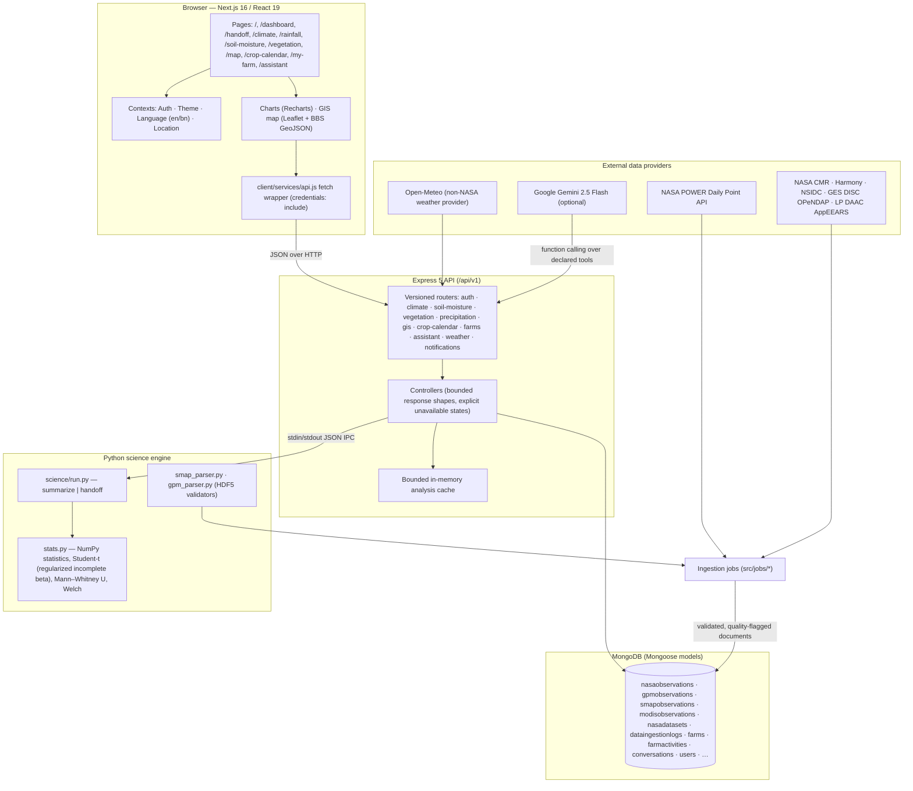

# Krishi Mama (কৃষি মামা)

**Climate-informed agricultural decision support for Bangladesh — Team NeuralMesh, NASA International Space Apps Challenge 2026**

> **Selected Challenge:** [Field Shift: Adapting Farms with NASA Data](https://www.spaceappschallenge.org/2026/challenges/field-shift-adapting-farms-with-nasa-data/)
> **Challenge summary (from the official Space Apps 2026 challenge listing):** *"Farmers around the world navigate shifting temperatures, changing rainfall patterns, water shortages, extreme weather, and declining soil health. These pressures make it difficult to choose crop rotations that protect fields, conserve water, and support long-term resilience. Your challenge is to create a decision-support tool that uses NASA Earth observations along with local soil information, crop characteristics, and farmer priorities to help farmers explore rotation strategies that could strengthen soil health and adapt their farms to changing conditions."*

> **Disclaimer:** Krishi Mama is an open-source competition submission. It is **not** an official NASA product and has not been certified or endorsed by NASA or any governmental agricultural authority. It is an information aid that supplements — and never replaces — local agricultural officers, field inspection, and official advisories.

- **Frontend repository:** https://github.com/shahed-hassan-fz-rabbi/Krishi_Client (`client/`)
- **Backend repository:** https://github.com/shahed-hassan-fz-rabbi/Krishi_server (`server/`)
- **Scientific formula version:** `v1.0.0-phase3`

> **About this file:** `PROJECT.md` documents the combined Krishi Mama root workspace (`client/` + `server/`). Files under `docs/` and the root-level report files referenced here live in the team's local submission workspace, not in this repository. Repository-specific documentation is in [README.md](README.md). Cross-repository links point to the companion repo [Krishi_Client](https://github.com/shahed-hassan-fz-rabbi/Krishi_Client).

---

## Table of contents

1. [Project overview](#project-overview)
2. [The agricultural problem](#the-agricultural-problem)
3. [Our solution](#our-solution)
4. [How Krishi Mama works](#how-krishi-mama-works)
5. [Features and implementation status](#features-and-implementation-status)
6. [NASA datasets](#nasa-datasets)
7. [Agricultural and geographic data sources](#agricultural-and-geographic-data-sources)
8. [Scientific data-quality rules](#scientific-data-quality-rules)
9. [Architecture](#architecture)
10. [Technology stack](#technology-stack)
11. [AI-assisted development and contribution disclosure](#ai-assisted-development-and-contribution-disclosure)
12. [Project structure](#project-structure)
13. [Installation and setup](#installation-and-setup)
14. [Environment configuration](#environment-configuration)
15. [API documentation](#api-documentation)
16. [Database structure](#database-structure)
17. [Testing and verification](#testing-and-verification)
18. [NASA challenge alignment](#nasa-challenge-alignment)
19. [Current geographical coverage](#current-geographical-coverage)
20. [Limitations and future roadmap](#limitations-and-future-roadmap)
21. [Demo and screenshots](#demo-and-screenshots)
22. [Official references and resource links](#official-references-and-resource-links)
23. [Team NeuralMesh and contributors](#team-neuralmesh-and-contributors)
24. [License and attribution](#license-and-attribution)

---

## Project overview

Krishi Mama (Bengali for "the farmer's trusted uncle") is a bilingual (English/Bangla) web application that turns **25 years (2001–2025) of NASA POWER daily agroclimatology observations**, delayed NASA satellite products (GPM IMERG, SMAP, MODIS), official Bangladesh crop calendars, and a farmer's own crop timeline into one transparent decision-support experience.

It is deliberately **not** a black-box forecaster. Historical frequencies, statistical period comparisons, and quality-filtered satellite observations are presented with their provenance, quality metadata, and limitations attached. The platform was developed for the NASA International Space Apps Challenge 2026, Challenge 7: *Field Shift: Adapting Farms with NASA Data*.

## The agricultural problem

In Bangladesh's intensive cropping systems, the transition between the monsoon (Kharif) and winter (Rabi) seasons is one of the most climate-sensitive phases of the agricultural calendar:

1. **The post-monsoon bottleneck (T. Aman → Mustard).** Farmers harvest transplanted monsoon Aman rice in late October and prepare land for winter Rabi mustard, whose sowing window is typically **November 1–20**. Excess residual moisture delays tillage; delayed mustard sowing increases flowering-period heat-stress risk (a project assumption requiring agronomic source verification).
2. **Soil workability constraints.** Preparing wet paddy fields requires a run of consecutive dry days. Late-monsoon rain in late October or early November can push seedbed preparation past the viable sowing window.
3. **Second handoff (Boro → Aus).** Irrigated Boro rice is harvested in late March–early April ahead of the pre-monsoon Aus rice sowing window (typically **April 1–20**), with similar workability constraints.
4. **Lack of accessible historical evidence.** Farmers and extension workers rarely have localized, multi-decade context on how rainfall patterns and sowing-opportunity frequency have varied — and even when data exists, it is rarely presented in Bengali, on a phone, without jargon.

## Our solution

Krishi Mama synthesizes a quarter-century of NASA Earth observations into understandable historical evidence and pairs it with official Bangladesh crop guidance and the farmer's own plan:

- **Crop Handoff Planner** — a 25-year daily-observation analysis of specific transitions (T. Aman → Mustard; Boro → Aus) with sowing-window dry-day frequency, median sowing dry days, late-October rainfall shift between two 12/13-year periods (Mann–Whitney U and Welch's t-test, computed deterministically in Python), yearly observation tables, an accessible SMS advisory (<160 characters, Bengali digits in Bangla mode), and a print/PDF field report.
- **Climate pages** — historical rainfall, temperature (mean/max/min, diurnal range) normals and series.
- **Environmental intelligence** — quality-filtered NASA SMAP surface soil moisture, MODIS NDVI/EVI vegetation indices, and GPM IMERG precipitation, each with explicit quality and limitation disclosures.
- **Interactive GIS map** — official BBS 2020 Admin-2 district boundaries with NASA observation context layers.
- **Crop calendar** — BAMIS/DAE/BRRI/BARI-sourced phenology calendars for Aman, Boro, Aus, and mustard across the two supported districts, aligned against satellite observations.
- **My Farm** — an authenticated farmer records farms, crop/planting details, lifecycle stage estimates, and field activities, with notifications and environment context joined to available NASA data.
- **AI agricultural assistant** — a Gemini function-calling chat that can only call **declared backend data tools** (climate, precipitation, crop-calendar, farm tools), cites those sources, and falls back to a deterministic grounded template when the model service is unavailable. It never invents observations.
- **Bilingual UI** (English/Bangla with Bengali numerals), light/dark themes, guest access for public analytical pages, and owner-scoped private farm/chat data.

## How Krishi Mama works

1. **Ingestion (offline, batch).** Backend jobs fetch NASA POWER daily point data per district, validate the response envelope against the live API contract (units, header echo, time standard, fill value), classify every observation day (`ok` / `missing_sentinel` / `absent`), and upsert idempotently into MongoDB. SMAP granules are discovered via NASA CMR, downloaded through Harmony/NSIDC or AppEEARS-backed flows, parsed by Python HDF5 validators, and stored only when quality rules pass. GPM IMERG granules are read via OPeNDAP and validated to the 48-interval local-day rule. MODIS vegetation is extracted through AppEEARS with pixel-reliability filtering.
2. **Serving (runtime).** The Next.js client calls the versioned Express API (`/api/v1`). Controllers check stored observations first; empty or insufficient databases produce an explicit `DATA_UNAVAILABLE` state (HTTP 503), never fabricated zeros.
3. **Science.** Climate statistics and the handoff analysis are executed by a deterministic Python (NumPy) engine invoked over stdin/stdout IPC (`server/science/run.py` subcommands `summarize` and `handoff`). Results are cached in bounded process memory keyed by formula version + dataset + query. No LLM performs or approximates any numerical calculation.
4. **Assistance.** The AI assistant (when `GEMINI_API_KEY` is configured) uses structured function calling to select approved tools; every fact it can state comes from tool results or official calendar data. A deterministic grounded fallback path exists for quota/network outages.
5. **Offline resilience.** Selected historical climate endpoints fall back to checked-in static snapshots (`server/data/snapshots/`) when MongoDB is unreachable. Snapshots are always labeled as such — they are never presented as live provider responses.



## Features and implementation status

Status classifications: **Implemented** (works against the current code and documented runtime), **Partial** (implemented with a named gap), **Experimental** (small pilot-scale data), **Planned** (not operational), **Blocked** (requires an external dependency).

| Feature | Where | Status | Notes |
|---|---|---|---|
| Public homepage & "How it works" | `/` | Implemented | API-backed data catalog with dated, sourced ticker content; unavailable-data states verified (Phase 8.9/8.10). |
| Climate dashboard | `/dashboard` | Implemented | 25-year multi-parameter historical summary; weather intelligence section; division point map. |
| Crop handoff planner (Aman→Mustard, Boro→Aus) | `/handoff` | Implemented | Sowing-window frequency, period-shift statistics, yearly tables, disclosures, SMS advisory, print report. Lighthouse accessibility 1.0 measured during verification. |
| Rainfall climatology | `/rainfall` | Implemented | Monthly/annual/seasonal groupings from `/climate/rainfall`. |
| Temperature climatology | `/climate` | Implemented | T2M/T2M_MAX/T2M_MIN and diurnal range. |
| SMAP soil moisture | `/soil-moisture` | Experimental | Real SPL3SMP_E V006 observations with quality flags 0/8 accepted, flag 9 rejected; pilot-scale record count (see [NASA datasets](#nasa-datasets)). Marginal-quality data is withheld from cards. |
| MODIS vegetation (NDVI/EVI) | `/vegetation` | Experimental | MOD13Q1.061, scale factor 0.0001, fill −3000, rank-0 primary-valid-observation policy; pilot-scale record count. |
| GPM IMERG precipitation | `/precipitation` (service + client sections) | Experimental | GPM_3IMERGHH V07B; daily totals require 48 valid half-hour intervals (UTC+6); incomplete days are not zero. |
| Interactive GIS map | `/map` | Implemented | Leaflet + react-leaflet; BBS 2020 Admin-2 polygons for Cumilla & Chattogram served from `/api/v1/gis/boundaries`. |
| Crop calendar | `/crop-calendar` | Implemented | BAMIS/DAE/BRRI/BARI-sourced calendars (checked-in JSON with source-document URLs) plus satellite alignment view. |
| NASA data catalog | `/data-sources` | Implemented | Dataset registry, point-in-time counts, provenance, units, LST disclosure. |
| Crop rotation preview | `/crop-rotation`, `/rotation-planner` | Implemented | Public preview endpoint (no auth); authenticated compare/explain/save. |
| Farmer authentication (email/phone + password) | `/login`, `/register` | Implemented | bcrypt + JWT session via HTTP-only cookies; rate-limited login. |
| Google OAuth | `/login` (button placeholder), `/auth/google*` (backend) | Partial | Backend routes/service exist; the frontend button is an inactive placeholder pending credentials/UX review. |
| My Farm (farms, lifecycle, activities, notifications) | `/my-farm` | Implemented | Owner-scoped authenticated APIs; activity generation from lifecycle templates; notification readiness. |
| Crop planning recommendations | `/my-farm/plan` | Implemented | Deterministic screening; suitability categories are project calculations, not agronomic guarantees. |
| AI assistant with grounded tools & fallback | `/assistant` | Implemented | Gemini function calling + deterministic grounded fallback; auth-required chat history (40 req/min). |
| Voice input / output | Assistant | Partial | Uses browser SpeechRecognition/SpeechSynthesis where the device provides it; no external speech service. |
| Bilingual (EN/BN) with Bengali numerals | Global | Implemented | Dictionary-based `t()`; BN digits in KPIs, tables, charts, SMS. |
| Light/dark themes | Global | Implemented | Persistent theme context; WCAG-checked contrast tokens on the handoff surface. |
| Guest access to public analytics | `/(public-data)/*`, public routes | Implemented | Public climate/GIS/calendar pages; private farm/chat data stays behind authentication. |
| Official weather warnings | `/weather/admin/*` | Partial | Admin-reviewed warning workflow (role-gated); zero warnings in latest read-only check; not a verified live BMD feed. |
| 64-district nationwide coverage | — | Planned | Gate-based roadmap only; see [Limitations](#limitations-and-future-roadmap). |
| Deployment (production hosting) | — | Planned | Configured for local development and demonstration; no production deployment. |

## NASA datasets

Product metadata below comes from the checked-in server dataset configurations (`server/src/config/{climate,gpm,smap,modis}.config.js`) and the dataset registry. Observation counts are the **Phase 8.10 point-in-time read-only runtime catalog check (2026-11-11)** — they are evidence of what was stored at that moment, not hardcoded UI values and not a guarantee of future database contents. Do not assume full product coverage from global product availability.

### NASA POWER — Daily Agroclimatology (Point)

- **Endpoint:** `https://power.larc.nasa.gov/api/temporal/daily/point` · community `AG` · dataset key `nasa:power:daily:point`
- **Historical window:** 2001-01-01 → 2025-12-31 (25 years; 9,131 solar days per point)
- **Parameters & units:** `PRECTOTCORR` mm/day · `T2M`, `T2M_MAX`, `T2M_MIN` °C · `RH2M` % · `ALLSKY_SFC_SW_DWN` MJ/m²/day
- **Time standard:** Local Solar Time (LST) — solar-day boundaries, **not** Bangladesh civil UTC+6. Every stored record and API response repeats the `timeStandard: "LST"` disclosure, and ingestion refuses responses whose header time standard does not match.
- **Quality handling:** header fill value −999 (and any value ≤ −900) is classified as `missing_sentinel`; date keys missing from a returned series are `absent`. Sentinel values are **never** converted to 0 and are never counted as valid observations. Response header echo (start/end, API version, sources) must match the request or ingestion refuses the chunk.
- **Stored (2026-11-11 check):** 109,572 records across the two configured districts, with per-run provenance (`dataingestionlogs`: requested vs. actual range, per-parameter ok/sentinel/absent counts, HTTP outcomes).
- **Limitation:** POWER is a historical archive/reanalysis-style climate product — it is context, **not live weather**; values are point interpolations (~0.5°-scale), not farm measurements.

### NASA GPM IMERG Final V07 — `GPM_3IMERGHH`

- **Source:** NASA GES DISC; granule access via OPeNDAP (`gpm1.gesdisc.eosdis.nasa.gov`) with CMR granule discovery
- **Cadence/grid:** 30-minute precipitation rate; ~0.1° (≈10 km) grid
- **Daily completeness rule (project):** a Bangladesh local civil-day (UTC+6) total is computed **only** when all 48 half-hour intervals for that local day are valid; source rates in mm/hr are converted per interval. Fill values are excluded; an incomplete day is reported incomplete/unavailable — **valid zero rainfall is never treated as missing, and missing is never treated as dry**.
- **Stored (2026-11-11 check):** 672 records (pilot window 2024-01-01 → 2024-01-07, two districts)
- **Limitation:** IMERG Final is a delayed product with release latency; a recent local day may not yet exist. Half-hourly rate → daily sums require the correct interval conversion.

### NASA SMAP — `SPL3SMP_E` V006 (Enhanced L3 Radiometer Global Daily 9 km)

- **Source:** NSIDC DAAC; discovery via CMR concept `C2938664763-NSIDC_CPRD`, subsetting via NASA Harmony and/or validated local HDF5 files
- **Cadence/grid:** daily AM/PM passes; 9 km EASE-Grid 2.0
- **Quality policy (project):** accepts retrieval **quality flags 0 and 8 only**; **flag 9 (retrieval failed) is rejected**; fill value −9999 excluded. The observation is stored with its quality provenance and surface-temperature context.
- **Stored (2026-11-11 check):** 3 records; the valid Cumilla observation is dated 2024-01-08; Chattogram currently returns *unavailable* for recommended-quality data.
- **Limitation:** SMAP measures **near-surface (≈ top 5 cm) volumetric soil moisture** — not root-zone moisture, not an in-field sensor, and a 9 km grid cell is not a farm value.

### NASA MODIS — `MOD13Q1.061` (Terra Vegetation Indices 16-Day L3 Global 250 m)

- **Source:** NASA LP DAAC; accessed via AppEEARS (`appeears.earthdatacloud.nasa.gov/api/v1`)
- **Cadence/grid:** 16-day composite; nominal 250 m sinusoidal grid
- **Value & quality policy (project):** integer scale factor **0.0001** when raw; fill **−3000**; scaled valid range −0.2…1.0. **Pixel-reliability rank 0 (good) is the only rank used as a primary valid observation**; rank 1 is marginal and must remain distinguishable (never presented as good); snow/ice and cloudy ranks are rejected. Marginal data is withheld from dashboard cards by design.
- **Stored (2026-11-11 check):** 6 records (2023-12-19 → 2024-02-18 pilot window)
- **Limitation:** NDVI/EVI indicate spectral vegetation greenness — they do not diagnose crop identity, pests, disease, or yield, and pixel-to-district assignment has spatial limitations.

## Agricultural and geographic data sources

| Source | What is used | Where in the project | Limitations |
|---|---|---|---|
| **BAMIS / DAE / BRRI / BARI** (Ministry of Agriculture, Bangladesh) | Official agro-meteorological crop calendars: varieties, sowing/harvest windows, durations for T. Aman, Boro, Aus, mustard in Cumilla & Chattogram, with source-document URLs (e.g., BAMIS calendar PDFs) | `server/data/crops/official_crop_calendars.json`, served via `/api/v1/crop-calendar`, used by the crop-calendar UI and handoff window configuration | Schedule references for the listed districts/seasons; not individualized suitability probabilities; Bengali text encoding in the source JSON has known mojibake in some non-critical fields |
| **BBS (Bangladesh Bureau of Statistics) Admin-2 boundaries via UN OCHA HDX** | `bgd_admbnda_adm2_bbs_20201113` district polygons for **Cumilla (BD2019)** and **Chattogram (BD2015)** | `server/data/gis/bbs_admin2_cumilla_chattogram.geojson`, served via `/api/v1/gis/boundaries`, rendered by Leaflet | Verified for two districts only; not national coverage; representative points give district context, not farm geometry |
| **Open-Meteo** (non-NASA weather provider) | Forecast/seasonal-outlook model output behind `/api/v1/weather/*` | `server/src/services/weather/*` | Third-party (not NASA); described per actual API response — no asserted SEAS5-only sourcing or calibrated tercile probabilities |
| **OSM raster tiles** (keyless) | Map basemap tiles | `client/components/map/DistrictGisMap.js` | Basemap imagery only; subject to OSM tile usage policy |
| NASA sources | POWER, GPM, SMAP, MODIS as above | ingestion jobs + data pages | See dataset sections |

## Scientific data-quality rules

These rules are enforced in code and reflected in the UI:

- **Historical POWER data is not live weather.** All climate pages are labeled as historical climatology with pending-independent-verification disclosures where applicable.
- **GPM daily totals require 48 valid half-hour intervals.** Partial coverage renders as incomplete/unavailable — never as a total, and never as zero.
- **Valid zero rainfall is different from missing data.** A zero is kept only where the provider value and quality pass validation; missing, fill, invalid, and not-yet-ingested values remain explicitly unavailable (never zero-filled).
- **SMAP accepts quality flags 0 and 8 only** (flag 9 = retrieval failure, rejected; fill −9999 excluded).
- **SMAP measures surface soil moisture (~top 5 cm), not root-zone moisture.** Every soil-moisture view repeats this disclosure.
- **MODIS primary valid observations require pixel-reliability rank 0.** Rank 1 is marginal and must remain distinguishable; marginal observations are not presented as good (withheld from dashboard cards).
- **Missing or invalid observations are never converted into zero**, and `no_observations` states are never rendered as zero rainfall.
- **District assignment requires appropriate spatial validation.** Representative district points and 0.1°–0.5° grids are regional context; the farm schema does not store verified parcel geometry, so no farm-level spatial precision is claimed.
- **NASA observations are decision-support evidence, not guaranteed agricultural recommendations.** Historical frequency is not future probability; the 5-consecutive-dry-day (Aman→Mustard) and 4-consecutive-day (Boro→Aus) thresholds are **project-defined operational proxies**, not WMO or national agronomic standards.
- Cached/snapshot fallbacks are always labeled; observation date, forecast valid date, retrieval time, and ingestion time are kept distinct.

## Architecture

See `docs/ARCHITECTURE.md` for the full narrative and the Mermaid diagram above for the system view. Key points:

- **Client** (`client/`): Next.js 16 App Router, React 19, Tailwind CSS v4; route groups separate the public data chrome (`(public-data)`) from the authenticated app shell (`(app)`); Leaflet/react-leaflet maps; Recharts charts; dictionary-based EN/BN i18n; contexts for auth (HTTP-only cookie sessions), theme, language, district location, and sidebar state. Client-side route visibility is **not** an authorization boundary.
- **Server** (`server/`): Express 5 ESM API with versioned routers mounted at `/api/v1` (`src/routes/v1/index.js`), controllers with bounded response shapes and explicit `DATA_UNAVAILABLE` (503) states, Mongoose 8 repositories, ingestion jobs (`src/jobs/`), provider clients with bounded retry/backoff (`src/services/nasa/`), weather services, and a Gemini-backed assistant with declared tools.
- **Authorization**: protected farm/assistant/rotation-plan operations use server-side middleware to establish identity and filter strictly by owner; client-supplied owner IDs never establish authorization. Guest chat is supported but is not equivalent to authenticated, saved conversations.
- **Python science CLI** (`server/science/`): `run.py` (`summarize`, `handoff`), `contract.py` (JSON I/O contract), `stats.py` (deterministic NumPy statistics; Student-t two-sided p-values via a custom regularized incomplete-beta implementation with a documented erfc normal-limit for df ≥ 10,000), `smap_parser.py` and `gpm_parser.py` (HDF5 validators).

## Technology stack

| Layer | Technology | Evidence |
|---|---|---|
| Frontend | Next.js 16.4.5, React 19.3, Tailwind CSS v4 (Turbopack), Recharts 3.x, Leaflet 1.9.4 + react-leaflet 5.x, Lucide icons | `client/package.json` |
| Backend | Node.js ≥ 18.18 (ESM), Express 5.1, Mongoose 8.19, bcryptjs, JWT (jsonwebtoken), cookie-parser, express-rate-limit, CORS | `server/package.json` |
| Database | MongoDB (Atlas-compatible) via Mongoose; 13 models/collections | `server/src/models/` |
| Science | Python ≥ 3.11, NumPy ≥ 2.0 (<3), h5py ≥ 3.10 (<4) | `server/science/requirements.txt` |
| AI runtime | Google Gemini (`@google/genai` 3.x, default `gemini-2.5-flash`) with function calling + deterministic grounded fallback | `server/src/services/ai/` |
| Auth | JWT sessions in HTTP-only cookies; Google OAuth 2.0 service (frontend button placeholder) | `server/src/services/auth/` |
| Data access | NASA POWER API; NASA CMR; NASA Harmony; NSIDC; GES DISC OPeNDAP; NASA AppEEARS | `server/src/config/{gpm,smap,modis}.config.js`, `src/services/nasa/` |
| Dev/test tooling | npm scripts, Node built-in test runner (`node --test`), `python -m unittest`, ESLint 9 flat config, `nodemon` | both `package.json` files |
| VCS / hosting of code | Git + GitHub (two repos) | `git log`, remotes in sub-READMEs |

## AI-assisted development and contribution disclosure

In line with the Space Apps Participants Guide's AI-use expectations, Team NeuralMesh discloses the following. **No AI model performs runtime climate calculations, estimates missing data, or generates analytical conclusions** — all statistics are computed deterministically by the Python/NumPy engine and validated ingestion code.

### AI tools with documented evidence

| Tool | Documented role | Evidence |
|---|---|---|
| **Google Antigravity (agent pair-programmer)** | Architecture planning, Express route scaffolding, frontend UI work, weather-intelligence integration, security audits, accessibility/UI audits, phase remediation, documentation drafting | Named "Auditor/Assigned Agent" in 15+ root reports (e.g., `PHASE_8_0_ANTIGRAVITY_WEATHER_INTEGRATION_REPORT.md`, `PHASE_7_0_4_ANTIGRAVITY_SECURITY_INDEPENDENT_AUDIT_REPORT.md`, `AUTHENTICATION_UPGRADE_REPORT.md`); disclosure tables in `client/README.md` and `server/README.md` |
| **OpenAI Codex (agent)** | Independent code audits, farm-security (IDOR/ownership) remediation, weather re-audits, project handover audits | Git branch `codex/krishi-homepage-premium` and stash `codex-preserve-before-teammate-sync-2026-11-11` (client repo); `PHASE_7_0_1/2/3_CODEX_*`, `PHASE_7_0_4_CODEX_FARM_SECURITY_REPORT.md`, `CODEX_PROJECT_HANDOVER_AUDIT.md` and related reports |
| **ChatGPT (OpenAI)** | Initial ideation, concept exploration, copy/language refinement, strategy text | Disclosure tables in `client/README.md` and `server/README.md` (human-verified against NASA POWER docs and BMD definitions) |
| **OpenCode (agent harness)** | Independent read-only verification phases (visual/accessibility audit, Student-t numerical verification, provenance code audit) and the preparation of this README | Current working session; results cross-checked by executing real test suites, production builds, and Lighthouse in-browser |
| **Google Gemini (Gemini 2.5 Flash)** | **Product feature, not a dev tool**: the in-app AI assistant uses function calling over declared backend tools; deterministic grounded fallback when unavailable | `server/src/services/ai/*`, `server/README.md` AI section |

Contribution-boundary rules that the team followed (documented in the phase reports): agents worked in separated scopes, cross-audited each other's work (e.g., Antigravity auditing Codex's farm-security fixes), preserved uncommitted work, and every AI-authored change was reviewed, tested, and validated by human developers before acceptance. Authorship that Git cannot establish is reported as *not independently established* in the audit reports rather than asserted.

### Development, research, and data-access tools

- **Directly used to implement project code:** Node.js/npm, Git + GitHub, Next.js/React/Tailwind toolchain, ESLint, Python + NumPy/h5py, MongoDB Atlas (database provider), MongoDB Compass-style read-only audit job (`server/src/jobs/audit-data-readonly.js`).
- **Data access and processing:** NASA POWER API, NASA CMR search, NASA Harmony, NSIDC DAAC, GES DISC OPeNDAP, NASA AppEEARS, NASA Earthdata credentials infrastructure (`earthdata.auth.js`).
- **Research and technical assistance:** official NASA POWER/GPM/SMAP/MODIS documentation, NSIDC/LP DAAC product pages, WMO climate-normal guidance, BMD agro-climatology references (cited in `server/README.md` §References).
- **Testing and verification:** Node built-in test runner, `python -m unittest`, production builds (`next build`), Lighthouse accessibility audits, read-only database audit jobs.

Human team contributions remain clearly represented in the Git history (below). No contribution percentages are claimed, and no code is attributed to a specific AI tool beyond the documented report evidence above.

## Project structure

```text
Krishi Mama/
├── client/                     # Next.js 16 web application
│   ├── app/                    # App Router pages
│   │   ├── (app)/              # Authenticated app shell: dashboard, handoff, my-farm, assistant, …
│   │   ├── (public-data)/      # Public data chrome: climate, rainfall, soil-moisture, vegetation, map, crop-calendar, data-sources
│   │   ├── login/, register/   # Auth pages
│   │   └── location-onboarding/, crop-rotation/
│   ├── components/             # ui/ · layout/ · charts/ · map/ · dashboard/ · climate/ · auth/ · home/
│   ├── contexts/               # Auth, Theme, Location, Sidebar providers
│   ├── lib/i18n/               # LanguageContext + EN/BN dictionaries
│   ├── services/api.js         # Single fetch wrapper (credentials, timeouts, error classification)
│   ├── tests/                  # Node built-in runner test files
│   └── public/images/          # Brand assets (logo.png, hero.png, auth-farmer.png)
├── server/                     # Express 5 API + data platform
│   ├── src/
│   │   ├── routes/v1/          # health, auth, districts, climate, data-sources, smap, modis, gpm, gis,
│   │   │                       # crop-calendar, assistant, farm, croplifecycle, cropplanning,
│   │   │                       # notification, divisions, weather, rotation
│   │   ├── controllers/        # Bounded response shapes; explicit unavailable states
│   │   ├── services/           # nasa/ (POWER, SMAP/CMR/Harmony, GPM/OPeNDAP, MODIS/AppEEARS),
│   │   │                       # climate/, weather/, ai/, auth/, handoff/, geospatial/
│   │   ├── jobs/               # ingest-power, ingest-smap, ingest-gpm-pilot, ingest-modis,
│   │   │                       # download-smap-harmony, fetch/submit-modis-appeears, audits
│   │   ├── config/             # climate/gpm/smap/modis configs, env, database
│   │   ├── models/             # 13 Mongoose models (see Database structure)
│   │   ├── validators/         # power.validator.js (request/response contract)
│   │   └── server.js, app.js
│   ├── science/                # Python engine: run.py, contract.py, stats.py, smap_parser.py,
│   │                           # gpm_parser.py, tests/ (56 tests), test_gpm_parser.py, requirements.txt
│   ├── data/                   # gis/ (BBS GeoJSON) · crops/ (official calendars) · smap/ · gpm/ ·
│   │                           # modis/ raw artifacts · snapshots/ (checked-in offline fallbacks)
│   └── tests/                  # Node unit/offline/integration/farmer-journey suites
├── docs/                       # ARCHITECTURE, NASA_DATASETS, SCIENTIFIC_LIMITATIONS, judge demo materials
└── PHASE_*_REPORT.md           # ~115 point-in-time implementation/audit reports (historical evidence)
```

## Installation and setup

### Prerequisites

- **Node.js ≥ 18.18** (npm ≥ 9) — tested on Node 20/22 LTS
- **Python ≥ 3.11** with pip (for the science engine: NumPy, h5py)
- **A MongoDB instance** reachable via a locally configured URI (e.g., a free MongoDB Atlas cluster or a local `mongod`)
- Optional runtime credentials (the app degrades gracefully without them): Google AI Studio key (assistant), NASA Earthdata credentials (SMAP/MODIS ingestion), Google OAuth client (sign-in placeholder)

### Steps

1. **Clone / open the workspace** (or the two GitHub repos above).

2. **Install dependencies:**

   ```powershell
   # Backend
   cd server
   npm install
   pip install -r science/requirements.txt   # science engine dependencies

   # Frontend
   cd ..\client
   npm install
   ```

3. **Configure environment files privately** (never commit real values; see [Environment configuration](#environment-configuration)):
   - `server/.env` — copy from `server/.env.example` and set at minimum `MONGODB_URI`, `JWT_SECRET`, `CORS_ORIGIN`/`CLIENT_URL`.
   - `client/.env.local` — set `NEXT_PUBLIC_API_BASE_URL=http://localhost:5000/api/v1`.

4. **Run in development:**

   ```powershell
   # Terminal 1
   cd server
   npm run dev          # Express API on http://localhost:5000

   # Terminal 2
   cd client
   npm run dev          # Web app on http://localhost:3000
   ```

5. **Production build (frontend):**

   ```powershell
   cd client
   npm run build
   npm run start -- --port 3000
   ```

6. **Optional data operations** (these **write** to the configured database — run only against a database you own):
   `npm run seed:districts`, `npm run ingest:power`, `npm run probe:smap`, `npm run download:smap`. A read-only audit exists at `node src/jobs/audit-data-readonly.js`.

If MongoDB or a provider is unreachable, pages show explicit unavailable/error states. Those states must not be interpreted as zero observations.

## Environment configuration

Variable **names only** — values are private and must never appear in logs, screenshots, reports, or commits:

| Variable | Repository | Purpose |
|---|---|---|
| `MONGODB_URI` / `MONGODB_TEST_URI` | server | Database connection (test URI takes precedence for tests) |
| `JWT_SECRET`, `JWT_EXPIRES_IN` | server | Session signing |
| `PORT`, `NODE_ENV`, `LOG_LEVEL` | server | Runtime basics |
| `CORS_ORIGIN`, `CLIENT_URL` | server | Allowed browser origins |
| `GEMINI_API_KEY`, `GEMINI_MODEL` | server | AI assistant (optional; deterministic fallback otherwise) |
| `EARTHDATA_TOKEN` / `EARTHDATA_USERNAME` + `EARTHDATA_PASSWORD` | server | NASA Earthdata (SMAP/MODIS ingestion) |
| `GOOGLE_CLIENT_ID`, `GOOGLE_CLIENT_SECRET`, `GOOGLE_CALLBACK_URL` | server | Google OAuth (optional) |
| `PYTHON` | server | Science interpreter override |
| `NEXT_PUBLIC_API_BASE_URL` (preferred) / `NEXT_PUBLIC_API_URL` (legacy) | client | Backend base URL |

Templates: [`server/.env.example`](.env.example) and `client/.env.example`. NASA credentials belong **only** in the backend environment — never behind a `NEXT_PUBLIC_` variable.

## API documentation

All endpoints are mounted under `/api/v1` (authoritative definitions: `server/src/routes/v1/index.js`). Envelopes: success `{ "success": true, "data": …, "meta": … }`, error `{ "success": false, "error": { "code", "message" } }`.

| Endpoint | Method | Auth | Purpose |
|---|---|---|---|
| `/health` | GET | Public | Liveness + database/dataset readiness |
| `/auth/register`, `/auth/login` | POST | Public (rate-limited) | Farmer account creation / login (email or identifier + password) |
| `/auth/me`, `/auth/logout`, `/auth/profile` | GET/POST/PATCH | Session | Identity restore, logout, profile update |
| `/auth/google`, `/auth/google/callback`, `/auth/google/token`, `/auth/google/status` | GET/POST | Public/mixed | Google OAuth flow (frontend button currently a placeholder) |
| `/districts` | GET | Public | Enabled districts + coordinates |
| `/climate/summary`, `/climate/latest` | GET | Public | 25-year multi-parameter summary / latest values; `DATA_UNAVAILABLE` (503) when the database is empty |
| `/climate/rainfall` | GET | Public | Historical rainfall (`grouping=monthly|annual|seasonal|daily`) |
| `/climate/temperature` | GET | Public | Temperature normals/series (`metric=t2m|tmax|tmin|all`) |
| `/climate/handoff` | GET | Public | Python handoff analysis (`district`, `transition=aman-mustard|boro-aus`) |
| `/data-sources` | GET | Public | Dataset catalog, point-in-time counts, provenance |
| `/soil-moisture/status|latest|history` | GET | Public | SMAP observations with quality metadata |
| `/vegetation/status|latest|history` | GET | Public | MODIS NDVI/EVI with quality metadata (marginal data withheld from cards) |
| `/precipitation/latest|daily|history` | GET | Public | GPM IMERG with 48-interval completeness semantics |
| `/gis/districts|boundaries|layers` | GET | Public | Supported districts, BBS Admin-2 GeoJSON, map layers |
| `/crop-calendar`, `/crop-calendar/crops`, `/crop-calendar/alignment` | GET | Public | Official BAMIS/DAE/BRRI/BARI calendars + satellite alignment |
| `/divisions`, `/divisions/intelligence` | GET | Public | Division-level representative context |
| `/weather/forecast|outlook|alerts|crop-planning` | GET | Optional auth | Open-Meteo-backed weather intelligence |
| `/weather/admin/warnings…` | POST/PATCH/GET | Admin role | Official-warning review/verification workflow |
| `/assistant/chat` | POST | Session (40/min) | Grounded AI chat (Gemini function calling + deterministic fallback) |
| `/assistant/conversations`, `/assistant/conversations/:id` | GET/PATCH/DELETE | Session (owner) | Saved chat history |
| `/farms`, `/farms/:id` | GET/POST/PATCH/DELETE | Session (owner-scoped) | Farm CRUD |
| `/farms/:id/lifecycle`, `…/refresh`, `…/environment` | GET/POST | Session (owner-scoped) | Crop lifecycle stages + environment join |
| `/farms/:id/activities…`, `/farms/activities/overview` | CRUD | Session (owner-scoped) | Field activities, generation, overview |
| `/crop-lifecycle/templates[/:cropCode]` | GET | Public | Stage reference templates |
| `/crop-planning/recommendations` | POST | Session | Deterministic crop-plan screening |
| `/notifications…` | GET/PATCH/DELETE | Session | Farmer notifications |
| `/rotations/preview` | POST | Public (20/min) | Rotation comparison preview |
| `/rotations/explain`, `/rotations/compare`, `/rotations/plans` | POST/GET | Session | Explanation (Gemini w/ deterministic fallback), compare, saved plans (owner-scoped) |

Example (public, no credentials):

```bash
curl "http://localhost:5000/api/v1/climate/handoff?district=cumilla&transition=aman-mustard"
```

A successful response contains the handoff configuration, sowing-opportunity statistics, period comparison, and yearly series with provenance/limitation metadata (`meta.time_standard = "LST"`, historical-frequency disclosures). When the database has no observations for the district, the API answers `503 DATA_UNAVAILABLE` — it does not fabricate data.

## Database structure

MongoDB collections (explicit names in `server/src/models/`):

| Collection | Purpose |
|---|---|
| `users` | Accounts (farmer/extension_officer/admin), phone/email auth |
| `farms` | Farmer farms (district/upazila context; no verified parcel geometry) |
| `farmactivities` | Scheduled/actual crop activities per farm |
| `farmnotifications` | Farm event notifications |
| `rotationplans` | Saved rotation comparisons (owner-scoped) |
| `conversations` | AI assistant chat history (authenticated) |
| `districts` | Supported-district metadata |
| `nasadatasets` | Dataset provenance registry (endpoint, units, fill values, LST disclosure, coverage) |
| `nasaobservations` | NASA POWER daily point observations (unique index districtCode+parameter+dateLabel; quality `ok`/`missing_sentinel`/`absent`; `ingestionRunId` + `provenanceDatasetId`) |
| `gpmobservations` | GPM IMERG half-hourly/local-day records with completeness accounting |
| `smapobservations` | SMAP soil moisture with quality-flag provenance |
| `modisobservations` | MODIS NDVI/EVI with pixel-reliability provenance |
| `dataingestionlogs` | Append-only ingestion journal (requested vs. actual range, sentinel/absent counts, HTTP outcomes, echoed API version/time standard) |
| `officialwarnings` | Admin-reviewed official weather warnings |

## Testing and verification

```powershell
# Client (Node built-in runner; 25 wired test files, ~130 cases)
cd client
npm test
npm run lint
npm run build

# Backend unit/offline suites (no database writes expected in unit suites)
cd server
npm run test:unit     # 17 files
npm run test:offline  # 2 files

# Integration suites (connect to a database — run ONLY against an isolated test DB)
npm run test:integration     # 15 files
npm run test:farmer-journey  # end-to-end journey checks

# Python science engine (deterministic statistics)
python -m unittest discover -s science/tests -v   # 56 tests
python -m unittest science.test_gpm_parser        # 4 tests
```

Recorded verification evidence (point-in-time): Python science suite **56/56 OK**; client unit suite passing (78 checks at Phase 9.7 handover); backend unit suite passing (51 checks after the JWT regression test); production builds green; Lighthouse Accessibility/Best-Practices/SEO = 1.0 on the handoff surface with a zero-failure manual WCAG scan in light and dark themes. Integration suites that write to a database must never be pointed at a production farmer database.

## NASA challenge alignment

Source: the official 2026 challenge listing (requirements paraphrased from the official statement quoted at the top of this README; the full official brief lives on spaceappschallenge.org).

| Challenge requirement | Krishi Mama implementation | Evidence in project | Status |
|---|---|---|---|
| Build a decision-support tool for crop-rotation exploration | Rotation preview/compare/explain planner + handoff planner across two documented transitions | `client/app/crop-rotation`, `app/(app)/rotation-planner`, `server/src/services/rotation.service.js`, `/handoff` | Implemented |
| Use NASA Earth observations | POWER (25 yr), GPM IMERG V07, SMAP SPL3SMP_E, MODIS MOD13Q1.061 — ingested, validated, quality-flagged, provenance-logged | `server/src/services/nasa/*`, `server/src/jobs/*`, `nasadatasets`/`dataingestionlogs` collections, `/data-sources` catalog | Implemented (SMAP/MODIS/GPM at pilot-scale record counts) |
| Local soil information | SMAP near-surface soil moisture as the satellite soil proxy + district context; honest disclosure that in-situ soil data is not integrated | `/soil-moisture` + quality policy; `docs/SCIENTIFIC_LIMITATIONS.md` | Partial (no in-situ soil survey integration yet) |
| Crop characteristics | Official BAMIS/DAE/BRRI/BARI calendars: varieties, durations, sowing/harvest windows per district/season | `server/data/crops/official_crop_calendars.json`, `/api/v1/crop-calendar` | Implemented |
| Farmer priorities | Farmer-defined farms, crops, planting dates, activities, plans; owner-scoped records | `/my-farm/*`, `farms`/`farmactivities` collections | Implemented |
| Rotation strategies that protect soil / conserve water | Historical rainfall & moisture context plus rotation comparison endpoints with explicit non-predictive framing | `/rotations/*`, `/climate/rainfall`, disclosures | Partial (decision support, not agronomic validation) |
| Adapt to changing conditions | Period-shift statistics (2001–2012 vs 2013–2025; Mann–Whitney U, Welch t) and handoff-frequency evidence | `server/science/stats.py`, `/handoff` period comparison | Implemented |
| Accessible to farmers | Bilingual EN/BN UI with Bengali numerals, mobile-first responsive design, SMS advisory, print report, voice I/O where available, guest access | i18n dictionaries, handoff SMS/print features, accessibility verification | Implemented |
| Transparent scientific basis | Deterministic NumPy engine, formula versioning, methodology & limitation disclosures on-screen, provenance logging | `server/science/`, on-page disclosure cards, `docs/NASA_DATASETS.md` | Implemented |
| Known limitations disclosed | Dedicated limitations documentation and UI states distinguishing unavailable/missing/marginal data | `docs/SCIENTIFIC_LIMITATIONS.md`, UI unavailable states | Implemented |

**Problem addressed / agricultural relevance:** the post-monsoon and pre-monsoon transition windows in Bangladeshi cropping systems, where a run of dry days determines whether the next crop can be sown on time. **Innovation:** combining multi-decadal POWER evidence with strict quality-flagged satellite products, official national calendars, and a grounded (non-hallucinating) assistant — with Bengali-first accessibility. **User impact:** historical evidence a farmer or extension officer can act on and print, not a black-box forecast.

## Current geographical coverage

**Currently supported districts: Cumilla and Chattogram.**

- POWER point ingestion, GIS polygons (BBS Admin-2), and crop calendars are configured and verified **only** for these two districts.
- Krishi Mama is **not** currently an operational 64-district platform. A nationwide expansion exists only as a gated roadmap (`NATIONWIDE_INGESTION_ROADMAP.md`, `NASA_64_DISTRICT_FEASIBILITY_AND_ARCHITECTURE_PLAN.md`, coverage matrix CSV).
- District-specific spatial validation and observation-quality filtering matter: each district has its own verified coordinates, boundary polygon, calendar entries, and quality-gated satellite records; data from one district is never substituted for another, and grid/pixel context is never presented as exact farm measurement.

## Limitations and future roadmap

**Known limitations (current):**

1. POWER is historical climatology — not live weather; a forecast must never be inferred from it.
2. GPM/SMAP/MODIS coverage is pilot-scale (single windows in 2023–2024) and product latency delays recent observations; stored range ≠ product range.
3. SMAP is surface (~5 cm) moisture at 9 km — not root-zone or farm-scale; MODIS NDVI/EVI is not disease/yield diagnosis.
4. Google OAuth is not active in the frontend; authentication uses email/phone + password.
5. The assistant requires a Gemini API key; without it the deterministic grounded fallback answers (and discloses missing inputs). Free-tier quotas limit live chat volume.
6. No production deployment; demonstration is local. Official-warning workflow shows zero warnings in the latest read-only check.
7. Farm records lack verified parcel geometry; district-level context only.
8. Some Bengali text inside the checked-in crop-calendar JSON has encoding artifacts (mojibake) in non-critical descriptive fields.
9. Historical frequencies and the dry-day proxy thresholds are decision-support heuristics, not agronomic guarantees.

**Roadmap (planned, not operational):** nationwide 64-district expansion via the gated ingestion roadmap (POWER → GPM → MODIS → SMAP → district APIs/UI), Google OAuth activation, production deployment, in-situ soil-data partnerships, and independent agronomic review of proxy thresholds.

## Demo and screenshots

Screenshots are **not bundled** in the repository. Available visual assets: `client/public/images/logo.png`, `hero.png`, `auth-farmer.png`, `footer-landscape.svg`. A static demo snapshot exists at `client/public/demo/cumilla-field-shift.json` — it is **disabled by code** (fail-closed) pending independent verification and must never be presented as NASA data.

Recommended screenshots for the final README (capture locally, save to `client/public/screenshots/`):

1. `01-dashboard-desktop.png` — multi-parameter climate dashboard (`/dashboard`).
2. `02-handoff-planner-desktop.png` — 25-year handoff chart + disclosures (`/handoff`).
3. `03-bilingual-bangla.png` — the interface in Bangla mode with Bengali numerals.
4. `04-mobile-view.png` — mobile navigation and responsive data pages.
5. `05-gis-map.png` — BBS boundary map with observation layers (`/map`).

Demo flow materials: `docs/JUDGE_DEMO_GUIDE.md`, `HACKATHON_LIVE_DEMO_SCRIPT.md`, `docs/JUDGE_FAQ.md`.

## Official references and resource links

**Challenge & guides**

- Field Shift challenge (official): https://www.spaceappschallenge.org/2026/challenges/field-shift-adapting-farms-with-nasa-data/ — linked from 2026 challenge listings; the full brief lives on spaceappschallenge.org
- NASA Space Apps 2026 hub: https://www.spaceappschallenge.org/
- Participants guides: https://www.spaceappschallenge.org/resources/ (index; specific guide PDFs were not available locally in this workspace — **not locally verified**)

**NASA data**

- NASA POWER: https://power.larc.nasa.gov/ · Daily API docs: https://power.larc.nasa.gov/docs/services/api/temporal/daily/ · Parameter catalog: https://power.larc.nasa.gov/parameters/
- NASA GPM: https://gpm.nasa.gov/ · GES DISC IMERG V07 summary: https://disc.gsfc.nasa.gov/datasets/GPM_3IMERGHH_07/summary
- NASA SMAP: https://smap.jpl.nasa.gov/ · NSIDC SPL3SMP_E V006: https://nsidc.org/data/spl3smp_e/versions/6
- NASA MODIS: https://modis.gsfc.nasa.gov/ · LP DAAC MOD13Q1.061 DOI: https://doi.org/10.5067/MODIS/MOD13Q1.061
- NASA Earthdata: https://earthdata.nasa.gov/ · CMR: https://cmr.earthdata.nasa.gov/search · Harmony: https://harmony.earthdata.nasa.gov · AppEEARS: https://appeears.earthdatacloud.nasa.gov/

**Bangladesh sources**

- BAMIS: https://www.bamis.gov.bd/ (calendar PDFs referenced per-record in the crop-calendar JSON)
- DAE: https://dae.gov.bd/ · BRRI: https://brri.gov.bd/ · BARI: https://bari.gov.bd/
- Bangladesh Bureau of Statistics: https://bbs.portal.gov.bd/ · UN OCHA HDX (boundary source platform): https://data.humdata.org/

**Stack documentation**

- Next.js: https://nextjs.org/docs · React: https://react.dev · Express: https://expressjs.com/ · Mongoose: https://mongoosejs.com/ · Tailwind CSS: https://tailwindcss.com/docs · Leaflet: https://leafletjs.com/ · Recharts: https://recharts.org/ · NumPy: https://numpy.org/doc/ · Open-Meteo: https://open-meteo.com/en/docs

WMO-No. 1203 climate-normals guidance and the statistical references (Hyndman & Fan 1996; Mann & Whitney 1947; Welch 1947) are cited in [`server/README.md`](README.md#references-and-citations). Links marked "not locally verified" could not be confirmed from workspace files.

## Team NeuralMesh and contributors

Development journey reconstructed from Git history (read-only; 39 frontend commits + 23 backend commits, 2026-11-07 → 2026-11-12):

- **codeinfinite19** (Shahed Hassan) — project initialization and architecture, NASA ingestion platform, science engine, multi-agent phase orchestration, dashboards and handoff UX, authentication hardening, test suites. (Most commits in both repos.)
- **mahjabin-alif-lamiya** — login/registration UI, navigation, footer, and crop-rotation UI contributions; email-and-phone authentication support.

AI agents (Antigravity, Codex, OpenCode) contributed as documented in the [AI disclosure](#ai-assisted-development-and-contribution-disclosure); their work was human-reviewed, tested, and validated. Confirmed presenter names/roles beyond the Git authors are not documented in the workspace and are therefore not invented here.

## License and attribution

- Code: the backend package metadata declares **MIT** (`server/package.json`); no root `LICENSE` file is currently present — teams reproducing this project should add one before redistribution.
- Data attribution survives code licensing: NASA data usage is subject to [NASA Earth science data guidelines](https://earthdata.nasa.gov/) (POWER, GES DISC, NSIDC, LP DAAC each publish their own terms); BBS/OCHA-HDX boundary data carries its own attribution terms; BAMIS/DAE/BRRI/BARI content remains Government of Bangladesh material; OpenStreetMap basemap tiles follow the [OSM tile usage policy](https://operations.osmfoundation.org/policies/tiles/); Open-Meteo is governed by its [CC-BY 4.0 attribution terms](https://open-meteo.com/en/license). Follow each source's applicable terms.

---

*Built by Team NeuralMesh for the NASA International Space Apps Challenge 2026. Krishi Mama is not an official NASA product.*
