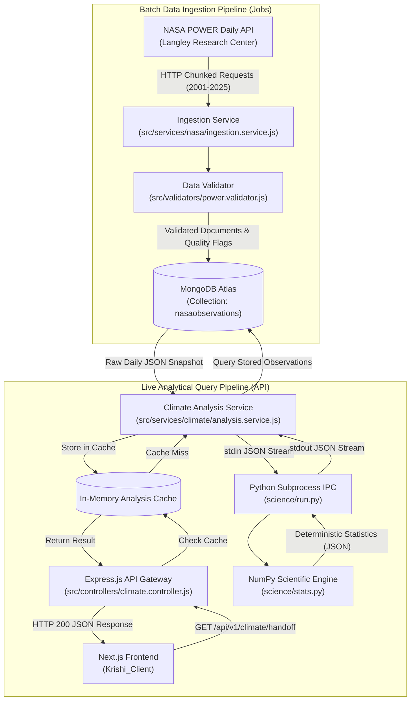

# Krishi Mama — Backend (`Krishi_server`)

**Data-Processing and Scientific Analysis Engine for Climate-Informed Agriculture**  
*Ingesting, Validating, and Modeling 25 Years of NASA POWER Earth Observations*

Developed for the **NASA International Space Apps Challenge 2026**  
**Selected Challenge:** Field Shift: Adapting Farms with NASA Data  
**Team:** NeuralMesh  

- **Backend Repository:** [https://github.com/shahed-hassan-fz-rabbi/Krishi_server](https://github.com/shahed-hassan-fz-rabbi/Krishi_server)
- **Frontend Repository:** [https://github.com/shahed-hassan-fz-rabbi/Krishi_Client](https://github.com/shahed-hassan-fz-rabbi/Krishi_Client)
- **Scientific Formula Version:** `v1.0.0-phase3`  
- **Runtime Environment:** Node.js (Express 5 REST API) + Python 3.11+ (NumPy 2.x Engine) + MongoDB Atlas

---

## Table of Contents

1. [Backend Responsibilities](#backend-responsibilities)
2. [System Architecture](#system-architecture)
3. [NASA Data Sources and Parameters](#nasa-data-sources-and-parameters)
4. [Data Coverage and Provenance](#data-coverage-and-provenance)
5. [Scientific Data Quality and Validation](#scientific-data-quality-and-validation)
6. [Crop Handoff Analysis Methodology](#crop-handoff-analysis-methodology)
7. [Statistical Methods and Mathematical Formulations](#statistical-methods-and-mathematical-formulations)
8. [API Reference Specification](#api-reference-specification)
9. [Installation and Environment Setup](#installation-and-environment-setup)
10. [Testing and Reproducibility](#testing-and-reproducibility)
11. [Data and Scientific Limitations](#data-and-scientific-limitations)
12. [Use of Artificial Intelligence](#use-of-artificial-intelligence)
13. [References and Citations](#references-and-citations)

---

## Backend Responsibilities

The `Krishi_server` repository provides the foundational data infrastructure and scientific calculation layer for the Krishi Mama platform. It is engineered around strict data integrity, reproducibility, and scientific transparency.

Key responsibilities include:
1. **Automated Ingestion and Validation:** Ingests raw daily agroclimatology feeds from the NASA POWER API, rigorously validates response structures, normalizes timestamps, and maps NASA `-999` sentinel fill values to explicit quality flags.
2. **Historical Observation Storage:** Persists 25 years of daily observations in MongoDB Atlas with unique compound indexes to guarantee idempotent upserts and zero record duplication.
3. **Deterministic Scientific Engine:** Executes rigorous statistical computations via a dedicated Python sub-process engine using pure NumPy. No numerical values or climate statistics are ever generated or approximated by Large Language Models.
4. **IPC Bridge & Service Layer:** Bridges Node.js/Express with the Python scientific engine via standard I/O (stdin/stdout) JSON streaming, returning standardized REST response envelopes.
5. **High-Performance Memory Caching:** Caches computationally intensive statistical handoff evaluations in-memory, accelerating subsequent identical queries from ~16 seconds to ~130 milliseconds.

---

## System Architecture

The Krishi Mama backend separates offline/batch historical data ingestion from real-time analytical API request execution:



---

## NASA Data Sources and Parameters

The primary observational foundation of Krishi Mama is the **NASA POWER (Prediction Of Worldwide Energy Resources) Daily Agroclimatology Point Dataset**.

- **Official API Endpoint:** `https://power.larc.nasa.gov/api/temporal/daily/point`
- **Dataset Key:** `nasa:power:daily:point`
- **Product Name:** NASA POWER Source Native Resolution Daily Data (Point)
- **Providing Facility:** NASA Langley Research Center (LaRC)
- **User Community:** Agroclimatology (`AG`)
- **Historical Analysis Window:** `2001-01-01` to `2025-12-31` (25 calendar years, 9,131 solar days per coordinate)
- **Time Standard:** **Local Solar Time (LST)**. The solar-day boundary is defined by the sun's local transit, which differs from civil Bangladesh Standard Time (BST, UTC+6). Every record and response explicitly tags and discloses `timeStandard: "LST"`.

### Configured Coordinates
The system operates exclusively on verified project coordinates for the targeted agricultural districts:

| District | Bangla Name | Latitude | Longitude | Elevation Context | Status |
|---|---|---|---|---|---|
| **Cumilla** | কুমিল্লা | `23.46186` | `91.18503` | Floodplain plain agro-ecological zone | **Primary Demo** |
| **Chattogram** | চট্টগ্রাম | `22.33840` | `91.83170` | Coastal agricultural zone | **Supported** |

### Implemented Climate Parameters
The backend ingests and validates six parameters directly relevant to soil moisture transition, evaporation, and thermal crop stress:

| Parameter Key | Unit | Description and Physical Meaning |
|---|---|---|
| `PRECTOTCORR` | `mm/day` | Precipitation Corrected (daily total precipitation). Primary parameter for wet/dry day classification. |
| `T2M` | `°C` | Daily mean temperature at 2 meters above earth's surface. |
| `T2M_MAX` | `°C` | Maximum daily temperature at 2 meters. |
| `T2M_MIN` | `°C` | Minimum daily temperature at 2 meters. |
| `RH2M` | `%` | Relative humidity at 2 meters. |
| `ALLSKY_SFC_SW_DWN` | `MJ/m²/day` | All-Sky Surface Shortwave Downward Irradiance (solar insolation). |

> **Official Documentation Links:**  
> - NASA POWER API Services: [https://power.larc.nasa.gov/docs/services/api/](https://power.larc.nasa.gov/docs/services/api/)  
> - NASA POWER Daily Point API: [https://power.larc.nasa.gov/docs/services/api/temporal/daily/](https://power.larc.nasa.gov/docs/services/api/temporal/daily/)  
> - NASA POWER Parameter Glossary: [https://power.larc.nasa.gov/parameters/](https://power.larc.nasa.gov/parameters/)

*Note on Gridded Earth Observations:* NASA POWER point data is produced via spatial interpolation from gridded satellite and meteorological assimilation models (~0.5° × 0.5° resolution). It provides regional climatological baselines but does not substitute for on-site micro-sensor measurements.

---

## Data Coverage and Provenance

The backend utilizes a hosted MongoDB Atlas database cluster (`development` environment; default database `test`):

- **Point-in-Time Audited Count:** Exactly `109,572` daily observation documents verified via `src/jobs/audit-data-readonly.js` and `/api/v1/health`.
- **Observations per District:** `54,786` documents each for Cumilla and Chattogram.
- **Calendar Coverage:** Exactly `9,131` days per district (including 6 leap-year days in 2004, 2008, 2012, 2016, 2020, and 2024).
- **Formula:** 2 districts × 9,131 days × 6 parameters = `109,572` total records.
- **Temporal Completeness:** 100% complete across all 6 parameters (0 missing dates, 0 duplicate records in audited dataset).
- **Compound Idempotent Index:**
  ```javascript
  { districtCode: 1, parameter: 1, dateLabel: 1 } // unique: true, name: "uniq_district_param_date"
  ```
  This index guarantees that subsequent ingestion runs or retry operations cannot introduce duplicate records.

---

## Scientific Data Quality and Validation

The ingestion validator (`src/validators/power.validator.js`) enforces strict physical and schema guardrails before records touch the database:

1. **Sentinel Fill-Value Mapping:** NASA POWER uses `-999` as a missing-data fill value. The validator detects this sentinel and stores the record with `quality: "missing_sentinel"`, `sentinelValue: -999`, and `value: null`. **Missing sentinels are NEVER converted to zero.**
2. **Missing Dates Classification:** Any date key absent from the returned NASA API dictionary is explicitly inserted with `quality: "absent"` and `value: null`. This preserves denominator integrity for multi-year averages.
3. **Physical Range Guardrails:**
   - Precipitation (`PRECTOTCORR`): Negative values are strictly rejected as invalid data.
   - Temperature (`T2M`, `T2M_MAX`, `T2M_MIN`): Negative values are accepted as physically valid, but extreme values (< -50°C or > 60°C) fail validation.
   - Relative Humidity (`RH2M`): Clamped to valid percentages [0, 100].
4. **Time Standard Uniformity:** The validator checks the response header's `time_standard` attribute. If it does not strictly match `"LST"`, the chunk is rejected to prevent mixed time-standard corruption.

---

## Crop Handoff Analysis Methodology

The central scientific feature of Krishi Mama is the **Crop Transition Handoff Analysis** (`server/science/stats.py`).

In intensive double- and triple-cropping rotations in Bangladesh, farmers must harvest one crop and prepare land for the next within a narrow window. High residual soil moisture prevents tractor or bullock tillage, causing seed rot or forcing delayed sowing that drastically reduces yields.

### Implemented Crop Transitions

The scientific engine configures and evaluates two distinct transition windows:

#### 1. Monsoon T. Aman Rice → Winter Rabi Mustard (Primary Demonstration)
- **Preceding Harvest Context:** Late October (October 16–31).
- **Target Sowing Window:** **November 1 – November 20** (20 expected calendar days).
- **Wet-Day Threshold:** Valid daily precipitation $\ge 1.0\text{ mm/day}$.
- **Dry-Day Threshold:** Valid daily precipitation $< 1.0\text{ mm/day}$.
- **Operational Workability Proxy:** **At least 5 consecutive dry days** during the November 1–20 window.
- **Completeness Rule:** Requires $\ge 90\%$ valid days in the window ($\ge 18$ valid days). Missing or sentinel dates immediately reset running dry streaks to 0 to prevent false-positive streaks.
- **Historical Result (Cumilla Baseline):**
  - **Workable Frequency:** **25/25 years (100%)**
  - **Mean Sowing Window Dry Days:** 17.16 days (median 17.0 days).
  - **Consecutive Dry Run Distribution:** Mean 14.52 days (median 14.0 days; min 7 days, max 20 days). Every single year exceeded the 5-day proxy.

#### 2. Boro Rice → Aus Rice (Secondary Transition)
- **Preceding Harvest Context:** Late March – Early April.
- **Target Sowing Window:** **April 1 – April 20** (20 expected calendar days).
- **Wet-Day Threshold:** Valid daily precipitation $\ge 1.0\text{ mm/day}$.
- **Dry-Day Threshold:** Valid daily precipitation $< 1.0\text{ mm/day}$.
- **Operational Workability Proxy:** **At least 4 consecutive dry days** during the April 1–20 window.
- **Completeness Rule:** Requires $\ge 90\%$ valid days in the window ($\ge 18$ valid days).
- **Historical Result (Cumilla Baseline):**
  - **Workable Frequency:** **21/25 years (84%)**
  - **Non-Workable Years:** Exactly 4 years failed the 4-consecutive-dry-day proxy:
    - **2002:** Max dry run = 3 days (12 dry days, 8 wet days, 43.9 mm rain).
    - **2004:** Max dry run = 1 day (3 dry days, 17 wet days, 147.4 mm rain).
    - **2018:** Max dry run = 3 days (5 dry days, 15 wet days, 141.6 mm rain).
    - **2020:** Max dry run = 3 days (7 dry days, 13 wet days, 123.2 mm rain).

> **Important Disclosure:** The 5-day and 4-day consecutive dry day criteria are **project-selected operational proxies** representing the minimum dry spell typically required for field drainage and seedbed preparation. They are not official government or WMO agronomic regulations.

---

## Statistical Methods and Mathematical Formulations

All numerical operations are executed in `server/science/stats.py` using double-precision floating-point arithmetic.

### 1. Climatological Normals and Percentiles
Percentiles ($P_{25}, P_{50}, P_{75}, P_{90}$) are computed using standard **Type 7 linear interpolation** (`np.percentile(..., method="linear")`, Hyndman & Fan 1996):
$$\text{Index} = (N - 1) \times \frac{q}{100}$$

### 2. Period Shift Comparison (Two-Sided Welch's t-test)
To investigate historical shifts, the 25-year record is divided into two distinct retrospective periods:
- **Period 1:** 2001–2012 ($n_1 = 12\text{ years}$)
- **Period 2:** 2013–2025 ($n_2 = 13\text{ years}$)

The test statistic $t$ and Welch–Satterthwaite degrees of freedom $\nu$ are defined as:
$$t = \frac{\bar{x}_2 - \bar{x}_1}{\sqrt{\frac{s_1^2}{n_1} + \frac{s_2^2}{n_2}}}$$
$$\nu = \frac{\left(\frac{s_1^2}{n_1} + \frac{s_2^2}{n_2}\right)^2}{\frac{(s_1^2 / n_1)^2}{n_1 - 1} + \frac{(s_2^2 / n_2)^2}{n_2 - 1}}$$

The exact two-sided p-value is evaluated via the regularized incomplete beta function $I_x$:
$$p = I_x\left(\frac{\nu}{2}, \frac{1}{2}\right), \quad x = \frac{\nu}{\nu + t^2}$$
For $\nu \ge 10{,}000$, the calculation safely transitions to the exact standard normal limit ($N(0,1)$).

### 3. Mann–Whitney U Non-Parametric Test
For non-normally distributed rainfall distributions, the Mann–Whitney $U$ test is evaluated using an asymptotic normal approximation with:
- Average ranks for tied observations.
- **Tie-corrected variance:**
  $$\sigma_U^2 = \frac{n_1 n_2 (N + 1)}{12} - \frac{\sum_k (t_k^3 - t_k)}{12 N (N - 1)}$$
- **0.5 continuity correction** applied toward the expected mean $\mu_U = \frac{n_1 n_2}{2}$.
- **Sample-Size Guard:** Requires $n_1, n_2 \ge 8$ for `approximation_valid: true`.

### Statistical Demonstration: Late-October Post-Monsoon Rainfall
- **Metric:** Total precipitation during late October (October 16–31) in Cumilla.
- **Period 1 (2001–2012):** Mean = $46.80\text{ mm}$ (median $19.64\text{ mm}$)
- **Period 2 (2013–2025):** Mean = $100.36\text{ mm}$ (median $66.17\text{ mm}$)
- **Welch's t-test Result:** $t = 1.609$, $\nu = 17.9$, $p = 0.125061$ ($p \approx 0.125$)
- **Mann–Whitney U Result:** $U = 52$, $z = -1.387$, $p = 0.1654$
- **Scientific Interpretation:** At the conventional significance threshold ($\alpha = 0.05$), $p \approx 0.125$ is **not statistically significant**. This shift represents exploratory descriptive evidence of increased late-season rainfall variability, but does **not** establish definitive climate-change attribution or agronomic causality.

---

## API Reference Specification

All backend endpoints are mounted under `/api/v1` and return standardized JSON envelopes.

### Primary Endpoints

| Method | Endpoint | Description | Query Parameters |
|---|---|---|---|
| `GET` | `/api/v1/health` | System health, database connectivity, and dataset status. | None |
| `GET` | `/api/v1/districts` | List of supported agricultural districts and coordinates. | None |
| `GET` | `/api/v1/climate/summary` | Multi-parameter 25-year climate summary. | `district` (required: `cumilla` \| `chattogram`) |
| `GET` | `/api/v1/climate/rainfall` | Aggregated rainfall series and monthly historical normals. | `district`, `grouping` (`monthly` \| `annual`) |
| `GET` | `/api/v1/climate/temperature` | Temperature distributions, monthly means, and diurnal ranges. | `district`, `metric` (`t2m` \| `all`) |
| `GET` | `/api/v1/climate/handoff` | Crop handoff analysis, sowing opportunities, and period comparisons. | `district`, `transition` (`aman-mustard` \| `boro-aus`) |
| `GET` | `/api/v1/data-sources` | Provenance metadata catalog and point-in-time observation counts. | None |

### Authentication Endpoints

| Method | Endpoint | Description | Payload |
|---|---|---|---|
| `POST` | `/api/v1/auth/register` | User registration (default role: `farmer`). | `{ name, email, password, preferredDistrict }` |
| `POST` | `/api/v1/auth/login` | User login establishing HTTP-only cookie. | `{ email, password }` |
| `GET` | `/api/v1/auth/me` | Fetch active user session profile. | Header / Cookie |
| `POST` | `/api/v1/auth/logout` | Terminate active user session. | None |

---

## Installation and Environment Setup

### System Prerequisites
- **Node.js:** Version `18.18.0` or higher (package engine: `>=18.18.0`).
- **Python:** Version `3.11` or higher.
- **Python Packages:** `numpy >= 2.0.0` installed in the host Python environment.
- **MongoDB Atlas:** A valid MongoDB connection string with read privileges (or read/write for ingestion).

### Step-by-Step Installation

1. **Clone the Repository:**
   ```bash
   git clone https://github.com/shahed-hassan-fz-rabbi/Krishi_server.git
   cd Krishi_server
   ```

2. **Install Node Dependencies:**
   ```bash
   npm install
   ```

3. **Verify Python Environment:**
   Ensure Python 3.11+ and NumPy are accessible on your system path:
   ```bash
   python --version
   python -c "import numpy; print('NumPy version:', numpy.__version__)"
   ```

4. **Configure Environment Variables:**
   Copy the example environment template:
   ```bash
   cp .env.example .env
   ```
   Configure the following required environment variable names in `.env` (never commit real values to Git):
   - `PORT`: Server listening port (default `5000`).
   - `NODE_ENV`: Application environment (`development` or `production`).
   - `MONGODB_URI`: MongoDB Atlas SRV connection string.
   - `CORS_ORIGIN`: Allowed frontend origin (e.g., `http://localhost:3000`).
   - `LOG_LEVEL`: Logging verbosity (`info` or `debug`).

5. **Start the Server:**
   - **Development (with hot reload):** `npm run dev`
   - **Production:** `npm start`
   The API will listen at `http://localhost:5000`.

---

## Testing and Reproducibility

The repository includes a comprehensive, multi-layer automated test suite:

### 1. Node.js Unit & Contract Tests
Runs validation logic, time standard guards, and Python CLI IPC contract tests without connecting to the database:
```bash
npm run test:unit
```
*Current Verified Result:* **36/36 tests passing** (6.4s).

### 2. Python Scientific Engine Tests
Executes the scientific test suite covering percentiles, incomplete-month thresholds, Student-t p-values, and consecutive dry streak calculations:
```bash
# Run from server directory
python -m unittest discover -s science/tests
```
*Current Verified Result:* **56/56 tests passing** (4.4s).

### 3. Read-Only Database Audit Job
Inspects the live database without making modifications:
```bash
node src/jobs/audit-data-readonly.js
```

---

## Data and Scientific Limitations

1. **Retrospective Climatology, Not Weather Forecasting:** The scientific engine computes descriptive statistics and historical probability distributions from past observations. It does not generate numerical weather forecasts or seasonal meteorological predictions.
2. **Historical Stability vs. Future Guarantees:** A 100% historical frequency over 2001–2025 indicates that the November sowing window has consistently provided workable dry spells in the past, but this does not constitute a future yield guarantee.
3. **Spatial Aggregation:** NASA POWER data represents point interpolations from gridded satellite models (~0.5° resolution) and does not capture local field-level microclimates, drainage gradients, or soil percolation variations.
4. **Proxy Assumptions:** The 5-day consecutive dry day threshold is an engineering approximation of tillage feasibility and must be interpreted alongside local on-ground soil inspections.
5. **Connectivity Requirements:** Live calculations require active database connectivity to MongoDB Atlas. A warm in-memory cache accelerates repeated queries but does not constitute full offline operation.

---

## Use of Artificial Intelligence

In compliance with the **NASA International Space Apps Challenge Participants Guide**, Team NeuralMesh discloses the following use of AI tools during the development of this repository:

| AI Tool | Role and Tasks Supported | Data Handled by AI | Verification by Human Developers |
|---|---|---|---|
| **Google Antigravity (Google DeepMind)** | System architecture, Express route scaffolding, Python NumPy numerical algorithms, test suite authoring, and documentation generation. | Schema models, test fixtures, statistical mathematical formulas, JSON API envelopes. | Every mathematical formula, degrees-of-freedom branch, and API controller was audited and regression-tested with independent unit tests. |
| **ChatGPT (OpenAI)** | Initial project structuring, ideation on agroclimatology proxies, and language refactoring. | Textual strategy descriptions and challenge guidelines. | Verified against official NASA POWER documentation and Bangladesh Meteorological Department definitions. |

**Scientific Integrity Statement:** Artificial intelligence was used as a software engineering and documentation accelerator. **At no point did any Large Language Model perform runtime climate calculations, interpolate missing values, or generate analytical conclusions.** All data processing is strictly executed by deterministic algorithms in Node.js and Python.

---

## References and Citations

### NASA Data and Technical Sources
- NASA Langley Research Center POWER Project: [https://power.larc.nasa.gov](https://power.larc.nasa.gov)
- NASA POWER Daily Point API Specification: [https://power.larc.nasa.gov/docs/services/api/temporal/daily/](https://power.larc.nasa.gov/docs/services/api/temporal/daily/)
- NASA POWER Parameter Catalog: [https://power.larc.nasa.gov/parameters/](https://power.larc.nasa.gov/parameters/)

### Climatological & Meteorological Standards
- Bangladesh Meteorological Department (BMD). *Agro-Climatic Zones and Seasonal Cycles of Bangladesh*. Government of Bangladesh.
- World Meteorological Organization (WMO). (2017). *WMO Guidelines on the Calculation of Climate Normals* (WMO-No. 1203). Geneva: WMO.

### Statistical Methodology
- Hyndman, R. J., & Fan, Y. (1996). "Sample Quantiles in Statistical Packages". *The American Statistician*, 50(4), 361–365. (NumPy Type 7 linear interpolation).
- Mann, H. B., & Whitney, D. R. (1947). "On a Test of Whether one of Two Random Variables is Stochastically Larger than the Other". *Annals of Mathematical Statistics*, 18(1), 50–60.
- Welch, B. L. (1947). "The generalization of 'Student's' problem when several different population variances are involved". *Biometrika*, 34(1/2), 28–35.
